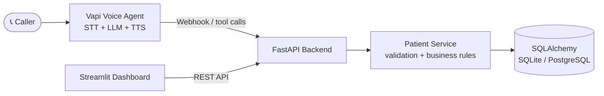

<div align="center">

# 🩺 CareCloud Voice AI — Patient Registration

**A voice-enabled patient registration demo: talk to an AI intake agent, get validated records in a database, manage them from a dashboard and REST API.**


[Dashboard](https://carecloud-voice-ai.streamlit.app/) · [API](https://carecloud-voice-ai.hostless.app/) · [Swagger Docs](https://carecloud-voice-ai.hostless.app/docs) · [Health Check](https://carecloud-voice-ai.hostless.app/health)

</div>

> [!WARNING]
> **Demo only.** This project uses **synthetic data**. It is **not HIPAA-compliant** and must not be used to collect or store real patient information.

> [!IMPORTANT]
> **Current voice limitation:** the Vapi web voice demo worked previously, but **new voice calls are currently blocked** because the Vapi wallet balance is negative. Vapi shows:
>
> *"Your Wallet Balance is -0.03. Please Purchase More Credits or Upgrade Your Plan Before Proceeding."*
>
> No additional credits have been purchased. The deployed **dashboard and API remain available** for demonstrating patient-management functionality, but live voice calls may be unavailable until the wallet issue is resolved.

---

## 📑 Table of Contents

- [Live Demo](#-live-demo)
- [Features](#-features)
- [Architecture](#-architecture)
- [Tech Stack](#-tech-stack)
- [Voice Registration Workflow](#-voice-registration-workflow)
- [API Endpoints](#-api-endpoints)
- [Local Setup](#-local-setup)
- [Environment Variables](#-environment-variables)
- [Testing](#-testing)
- [Known Limitations](#-known-limitations)
- [Security & Privacy](#-security--privacy)
- [Future Improvements](#-future-improvements)
- [Author](#-author)

---

## 🌐 Live Demo

| Component | Link |
|---|---|
| 📦 GitHub Repository | [K-Jeiya/carecloud-voice-ai](https://github.com/K-Jeiya/carecloud-voice-ai) |
| 📊 Streamlit Dashboard | [carecloud-voice-ai.streamlit.app](https://carecloud-voice-ai.streamlit.app/) |
| ⚙️ API | [carecloud-voice-ai.hostless.app](https://carecloud-voice-ai.hostless.app/) |
| 📖 Swagger Documentation | [/docs](https://carecloud-voice-ai.hostless.app/docs) |
| ❤️ Health Check | [/health](https://carecloud-voice-ai.hostless.app/health) |

---

## ✨ Features

- 🗂️ Patient registration, retrieval, update, and **soft delete**
- 🔍 Patient search, input validation, and structured API errors
- 📊 Streamlit dashboard for patient management
- 🎙️ Vapi voice-agent integration with webhook/tool-call handlers
- 🔁 Duplicate-patient lookup and update workflow
- 📝 Call-log endpoint and database persistence
- 🧪 Synthetic-data support for safe demonstrations

---

## 🏗️ Architecture



**Design principle:** the LLM never decides what is valid. It calls backend tools, and the backend (Pydantic + service layer) is the authority on validation, duplicates, and saving.

---

## 🧰 Tech Stack

| Technology | Purpose |
|---|---|
| **Python** | Application logic |
| **FastAPI** | REST API and webhook endpoints |
| **Pydantic** | Data validation |
| **SQLAlchemy** | Database access |
| **SQLite / PostgreSQL** | Data persistence options |
| **Streamlit** | Patient-management dashboard |
| **pytest** | Automated testing |
| **Vapi** | Voice-agent integration |

---

## 🎙️ Voice Registration Workflow

1. Collect patient details through natural conversation.
2. Validate fields through backend tools.
3. Re-ask only for missing or invalid information.
4. Read back everything and ask for confirmation.
5. Register the patient **only after explicit confirmation**.
6. Detect existing patients (by phone number) and offer an update instead of a duplicate.
7. Store call information through the call-log workflow.

> Live voice calls are currently limited by the Vapi wallet balance described [above](#-live-demo).

---

## 🔌 API Endpoints

| Method | Endpoint | Purpose |
|:---:|---|---|
| `GET` | `/health` | Check API and database health |
| `GET` | `/patients` | List and search patient records |
| `POST` | `/patients` | Create a patient record |
| `GET` | `/patients/{patient_id}` | Retrieve a patient |
| `PUT` | `/patients/{patient_id}` | Update a patient (partial updates) |
| `DELETE` | `/patients/{patient_id}` | Soft-delete a patient |
| `GET` | `/patients/{patient_id}/calls` | Retrieve patient call logs |
| `POST` | `/voice/webhook` | Handle Vapi webhook requests |
| `GET` | `/voice-ui` | Serve the voice interface |

For request schemas, response formats, and interactive testing, open the [Swagger UI](https://carecloud-voice-ai.hostless.app/docs).

### 🧪 Quick API Examples

<details>
<summary><b>Create a patient</b></summary>

```bash
curl -X POST https://carecloud-voice-ai.hostless.app/patients \
  -H "Content-Type: application/json" \
  -d '{
    "first_name": "Jane",
    "last_name": "Synthetic",
    "date_of_birth": "03/04/1990",
    "sex": "Female",
    "phone_number": "(202) 555-0101",
    "address_line_1": "100 Demo Street",
    "city": "Springfield",
    "state": "IL",
    "zip_code": "62701"
  }'
```

Responses use a consistent envelope:

```json
{ "data": { "patient_id": "…", "first_name": "Jane", "…": "…" }, "error": null }
```

</details>

<details>
<summary><b>Search patients</b></summary>

```bash
curl "https://carecloud-voice-ai.hostless.app/patients?last_name=synth&limit=20&offset=0"
```

Supported filters: `last_name`, `date_of_birth`, `phone_number`.

</details>

<details>
<summary><b>Validation error example (422)</b></summary>

```json
{
  "data": null,
  "error": {
    "code": "validation_error",
    "message": "Validation failed - phone_number: phone number must be a valid US 10-digit phone number (got 3 digits)",
    "details": [{ "field": "phone_number", "message": "..." }]
  }
}
```

</details>

---

## 💻 Local Setup

**Requirements:** Python 3.12, Git, and Windows PowerShell (or another terminal).

### 1. Clone the repository

```powershell
git clone https://github.com/K-Jeiya/carecloud-voice-ai.git
cd carecloud-voice-ai
```

### 2. Create and activate a virtual environment

```powershell
py -3.12 -m venv .venv
.\.venv\Scripts\Activate.ps1
```

If PowerShell blocks activation:

```powershell
Set-ExecutionPolicy -Scope Process Bypass
.\.venv\Scripts\Activate.ps1
```

### 3. Install dependencies and configure environment

```powershell
pip install -r requirements.txt
Copy-Item .env.example .env
```

Edit `.env` for your local environment. **Never commit secrets or API keys.**

### 4. Run the API

```powershell
uvicorn app.main:app --reload --port 8000
```

- Swagger UI: <http://localhost:8000/docs>
- Health check: <http://localhost:8000/health>

Keep this terminal running.

### 5. Run the dashboard (second terminal)

```powershell
.\.venv\Scripts\Activate.ps1
$env:API_BASE_URL = "http://localhost:8000"
streamlit run dashboard/app.py
```

Open <http://localhost:8501>. The dashboard requires the API to be running and reachable.

---

## 🔐 Environment Variables

| Variable | Purpose |
|---|---|
| `DATABASE_URL` | Database connection string |
| `API_KEY` | Optional API authentication |
| `VAPI_SERVER_SECRET` | Verifies incoming Vapi webhook requests |
| `PUBLIC_BASE_URL` | Public backend URL used by the configuration printer |
| `API_BASE_URL` | Backend URL used by the dashboard |
| `DASHBOARD_API_KEY` | Optional dashboard API key |

Configure secrets with environment variables or **Streamlit Secrets**. Never commit API keys, access tokens, or `.env` files.

---

## ✅ Testing

Run the automated test suite from the project root:

```powershell
python -m pytest -q
```

> Confirm the results by running the tests in your current repository checkout.

Use **synthetic data only** when testing registration, updates, duplicate detection, validation, and deletion.

---

## ⚠️ Known Limitations

- New Vapi voice calls are currently blocked by the wallet-credit issue.
- Appointment scheduling is not implemented.
- Not HIPAA-compliant; production use would need stronger security, access controls, monitoring, and privacy safeguards.
- Voice-call quality and real telephone calling should not be considered fully verified unless tested successfully.

---

## 🛡️ Security & Privacy

- Use synthetic patient data only.
- Keep API keys and webhook secrets out of source code and Git history.
- Configure authentication where required.
- Do not use this demo to collect or store real patient information.

---

## 🚀 Future Improvements

- [ ] Appointment scheduling workflow
- [ ] Database migrations (Alembic)
- [ ] Stronger authentication and authorization
- [ ] Rate limiting and operational monitoring
- [ ] Expanded automated tests and voice-quality evaluation
- [ ] Further multilingual voice testing

---

## 👩‍💻 Author

**Jeiya Kumari** — GitHub: [@K-Jeiya](https://github.com/K-Jeiya)

<sub>CareCloud Voice AI is a demonstration project showcasing conversational patient intake, backend validation, database-backed record management, and dashboard integration.</sub>
